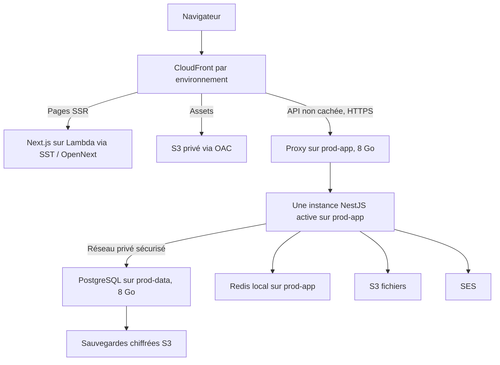

# Architecture de lancement hybride - Tickr

**Version :** 2.2 - plan de préparation du 2026-11-01

**Statut :** architecture de lancement retenue ; configuration, tests et mise en ligne encore à réaliser. Aucun critère de recette ci-dessous n'est déclaré réussi par la rédaction de ce document.

**Contexte :** ingénieur solo, lancement gratuit pour les utilisateurs, paiements en ligne différés.

## 1. Recommandation pour le lancement

Un compte AWS personnel sécurisé, deux environnements `production` et `staging`, un frontend Next.js sur SST v3 / OpenNext et trois VPS : **deux de 8 Go en production, un de 4 Go en hors-prod**. Utiliser S3 pour les fichiers et les sauvegardes, et SES pour les emails. Séparer le serveur applicatif prod du serveur PostgreSQL, chez le même fournisseur et dans la même région.

**Décision Redis pour le lancement : Redis auto-hébergé sur le VPS applicatif prod**, avec une instance distincte sur le VPS hors-prod. Pas d'ElastiCache, de VM Redis dédiée ni de cluster Redis au départ. Préparer dès maintenant la portabilité de la configuration, puis migrer vers ElastiCache privé lorsque le backend sera lui-même sur AWS et que le budget le permettra.

**Évaluation : 8,5/10 pour l'adéquation au lancement solo**, pas pour la disponibilité garantie. Le frontend bénéficie de CloudFront et le backend conserve un coût fixe réduit. Les risques principaux de la configuration retenue sont la panne d'un serveur prod, la saturation Redis/PostgreSQL et l'échec d'une restauration. Il n'est pas nécessaire de créer une structure multi-comptes pour commencer.

AWS Organizations est un service de gouvernance technique, pas un statut juridique. Un particulier peut l'utiliser, mais une société ou un label startup n'est ni nécessaire pour ouvrir un compte AWS ni une raison de complexifier l'infrastructure maintenant. Les conditions juridiques et contractuelles d'une future activité payante devront être vérifiées séparément.

**Capacité retenue :** 8 Go + 8 Go + 4 Go. Le prix des trois VPS reste à confirmer par devis ; l'ancienne hypothèse de 10-15 USD/mois ne vaut pas devis pour cette capacité. Les 100 USD personnels restent considérés comme une réserve AWS totale, en plus des crédits effectivement accordés. Gratuit pour l'utilisateur ne signifie pas gratuit à héberger. Le plan ne suppose aucun financement ou crédit startup futur.

### Comment utiliser ce plan

- **Retenu** : appliquer la décision lors de l'implémentation ; ne pas rouvrir le choix Redis, le nombre de VPS ou la séparation app/data sans nouveau besoin.
- **À réaliser** : travail technique nécessaire, même quand la formulation décrit la configuration cible au présent. Aucun fichier de déploiement ne doit être supposé prêt à partir de ce texte.
- **À renseigner** : information externe indispensable ; ne pas inventer une IP, un prix, un domaine détenu ou un identifiant AWS.
- **GO / NO-GO** : preuves à obtenir dans la section 8 avant d'ouvrir le service ; leur absence bloque la mise en ligne, pas la poursuite du développement local.

Le propriétaire du projet est responsable de l'exploitation, des alertes, des sauvegardes et du GO de production. Une validation manuelle en solo est une checklist enregistrée dans la livraison, pas une approbation fictive par une deuxième personne.

| Information à renseigner | Où la conserver | Bloque |
| --- | --- | --- |
| Fournisseur, région, vCPU, SSD, trafic, réseau privé et devis des trois VPS | Inventaire de déploiement, sans secrets | Commande des VM |
| Domaine réellement détenu et accès DNS | Inventaire de déploiement | Certificats et URLs publiques |
| ID du compte AWS, région, solde/expiration des crédits et budget accepté | Inventaire et console Billing ; aucun credential | Provisionnement AWS |
| IP publiques/privées des hôtes et IP administratives autorisées | Inventaire de déploiement | Pare-feu et installation |
| Adresse de réception des alertes et procédure d'accès d'urgence | Gestionnaire de mots de passe pour les moyens d'accès | GO production |

Les noms de domaines de ce document restent des exemples jusqu'à confirmation de propriété. Les secrets ne figurent jamais dans cet inventaire versionné.

## 2. Topologie minimale



| Élément | Production | Hors-prod partagé |
| --- | --- | --- |
| Stage / branche | `production` / `main` | `staging` / `develop` |
| Domaine proposé, si détenu | `tickr.tn` | `staging.tickr.tn` |
| Compte AWS | Même compte initial | Même compte initial |
| AWS | Distribution, buckets, secrets, rôles et état SST propres | Ressources distinctes, permissions limitées à staging |
| VPS retenus | `prod-app` 8 Go : proxy, NestJS, Redis ; `prod-data` 8 Go : PostgreSQL et agent de sauvegarde | `staging` 4 Go : proxy, NestJS, PostgreSQL, Redis ; données synthétiques |
| Accès | Public avec authentification applicative | Accès équipe restreint ; `noindex` ne suffit pas |
| Paiement | Pas de paiement en ligne au lancement | Tests sandbox seulement lorsque nécessaires |

Les deux VM prod séparent application et données ; elles ne constituent ni deux réplicas du backend ni un cluster PostgreSQL. **Une panne de l'une des deux peut interrompre le service : cette topologie n'est pas hautement disponible.** Ne pas utiliser le VPS hors-prod comme secours automatique de production. Prévoir la reconstruction de chaque rôle depuis sa configuration et les sauvegardes.

Sur `prod-app`, garder Redis dans le réseau Docker privé sans publication du port 6379. Sur `prod-data`, autoriser PostgreSQL uniquement depuis `prod-app` et les accès administratifs nécessaires, avec TLS validé. Préférer le réseau privé du fournisseur ; s'il n'existe pas, utiliser un tunnel WireGuard entre les deux hôtes, jamais PostgreSQL exposé à Internet. Le hors-prod n'a aucun accès réseau ou secret de prod.

Les 8 Go ne garantissent pas la capacité : vérifier aussi vCPU, performances disque, espace utile, trafic inclus et latence inter-VM. Borner mémoire/connections PostgreSQL et mémoire Redis en gardant de la marge OS. Construire les images en CI. Une seule instance NestJS et ses crons sont actifs au lancement ; un second backend nécessite un audit préalable des verrous et de l'idempotence.

Le développement local reste sur Docker Compose. Le hors-prod de 4 Go reste distinct ; sa disponibilité peut être réduite si le fournisseur facture réellement à l'usage. Éteindre une VM ne stoppe pas nécessairement sa facturation ; vérifier aussi volumes, IP et snapshots.

### Socle d'exploitation retenu

| Sujet | Décision de lancement | Vérification avant utilisation |
| --- | --- | --- |
| OS / architecture | Ubuntu 24.04 LTS x86-64 sur les trois VPS | Images disponibles chez le fournisseur, correctifs appliqués |
| Exécution | Docker Engine + plugin Compose v2 ; images construites en CI | Versions exactes enregistrées ; services redémarrent après reboot |
| Proxy | Nginx sur prod-app et staging, certificats Let's Encrypt renouvelés par challenge DNS | Renouvellement testé ; credentials DNS limités à la zone nécessaire |
| Reproductibilité | Ansible pour les hôtes, Compose pour les services, SST v3 pour le frontend et les ressources AWS | Deuxième exécution Ansible sans changement inattendu ; aucun rôle Ansible supposé existant |
| Registre | GHCR privé ; CI publie avec `GITHUB_TOKEN`, VPS tire avec un token dédié `read:packages` seulement | Accès privé vérifié ; coût/quota du plan GitHub contrôlé ; token protégé et renouvelé avant expiration |
| Secrets VPS | Gestionnaire de mots de passe comme copie de récupération ; fichiers hors dépôt, permissions 0600, dans le répertoire de déploiement protégé | Aucun secret dans image, artefact CI, sortie de commande ou logs ; accès Docker traité comme privilégié |
| Versions DB/cache | Conserver initialement les majeures PostgreSQL 15 et Redis 7 utilisées en local, prendre un patch maintenu et épingler son digest après tests | Aucun `latest` ni ancien patch repris sans contrôle ; évolution de majeure séparée du changement d'hébergeur |

Ces choix sont à implémenter ; ils ne déclarent pas les fichiers actuels conformes. Le fichier Nginx existant est exclu de l'accès Copilot dans cette session : sa conformité n'a pas pu être vérifiée. Ne pas copier sa configuration en production sans une revue autorisée.

### Matrice réseau cible

| Destination | Port entrant | Sources autorisées |
| --- | --- | --- |
| prod-app / staging | TCP 443 | HTTPS public, mais proxy refusant toute requête sans secret d'origine valide ; staging reste aussi filtré côté CloudFront |
| Trois VPS | TCP 22 | IP administratives explicites ; clés SSH uniquement, pas de login root distant ni mot de passe |
| prod-data | TCP 5432 sur interface privée/tunnel | IP privée de prod-app ; administration par tunnel SSH, pas par ouverture publique |
| NestJS | TCP 3000 | Réseau Docker local depuis Nginx seulement ; aucune publication sur l'IP publique |
| Redis | TCP 6379 | Réseau Docker local depuis NestJS seulement ; aucune publication sur l'hôte |
| WireGuard, seulement si nécessaire | UDP 51820 | IP publique de l'autre serveur prod uniquement |

Tout autre trafic entrant est refusé, y compris TCP 80 grâce au challenge DNS. Autoriser en sortie les besoins documentés : DNS, synchronisation horaire, HTTPS vers AWS/GHCR/dépôts OS et les flux privés app-DB. Le pare-feu fournisseur et les règles effectives Docker doivent être testés ; UFW seul ne garantit pas le filtrage des ports publiés par Docker. Tester IPv4 et IPv6 ou désactiver l'exposition IPv6 non maîtrisée.

### Configuration DB commune : travail bloquant

Dans [DatabaseModule](../../backend/src/shared/infrastructure/database/database.module.ts), le runtime utilise `DB_*` et active `synchronize` lorsque `NODE_ENV=development`. Dans [data-source.ts](../../backend/src/shared/infrastructure/database/data-source.ts), la CLI préfère `DATABASE_URL` si présente. Aucun des deux chemins ne configure explicitement la validation TLS dans le code lu.

Pour les deux environnements déployés : `NODE_ENV=production`, `DB_HOST`, `DB_PORT`, `DB_USERNAME`, `DB_PASSWORD`, `DB_DATABASE` cohérents, et **pas de `DATABASE_URL` parallèle** tant que les chemins ne sont pas harmonisés. Le nom du stage reste `staging` ou `production` ; il ne remplace pas `NODE_ENV`. Ne pas compter sur `DB_SYNCHRONIZE=false` seul pour neutraliser le comportement actuel en mode development.

Avant connexion inter-VM : ajouter une configuration partagée au runtime et à la CLI pour TLS, CA de confiance, validation du certificat et timeouts ; tester qu'un certificat invalide est refusé. Séparer l'utilisateur applicatif, sans droits de modification du schéma, de l'utilisateur de migration. Vérifier que les deux visent la même base avant chaque livraison. `DB_POOL_MAX=10` par instance applicative est le point de départ à tester, pas un réglage de performance garanti.

## 3. Compte AWS et crédits : ordre de préparation

1. Ouvrir un compte avec une adresse personnelle durable, un gestionnaire de mots de passe, des contacts facturation/sécurité à jour et un moyen de paiement. Choisir Basic Support. Saisir les données sensibles directement dans la console, jamais dans le chat ni Git.
2. Protéger root avec MFA/passkey et un moyen de récupération séparé. Ne créer aucune access key root et ne pas travailler quotidiennement en root. Préparer un accès administratif temporaire via fédération ; à défaut, un utilisateur IAM de console avec MFA et sans clé CLI permanente, assumé comme étape transitoire.
3. Distinguer **Free Plan** et **crédits Free Tier**. Le Free Plan est une offre d'évaluation limitée à six mois ou épuisement des crédits ; ses conditions déconseillent les données sensibles. Passer en Paid Plan avant d'accueillir des utilisateurs réels. Paid Plan n'annule pas automatiquement les crédits encore éligibles, mais permet la facturation au-delà.
4. Vérifier dans Billing le montant réellement accordé, l'expiration et les services éligibles. AWS annonce 100 USD pour un nouveau client éligible, plus jusqu'à 100 USD via activités ; ce bonus n'est ni garanti ni le versement personnel prévu. Les conditions consultées prévoient une expiration des crédits douze mois après ouverture.
5. **Ne pas activer Organizations maintenant pour ce plan.** Les conditions AWS disent qu'un Free Plan enrôlé dans Organizations passe en Paid Plan et ne peut plus utiliser ni gagner les crédits Free Tier. Ne pas supposer qu'un passage préalable en Paid Plan contourne cette restriction ; vérifier avec AWS Billing Support au moment d'une migration. Pas de multiplication des comptes pour multiplier les crédits.
6. Configurer budgets, alertes et suivi des crédits avant les ressources. Les 100 USD personnels sont une réserve, pas un plafond automatique AWS. Suivre la consommation brute avant crédits et le montant restant à payer.
7. Retenir initialement `eu-west-1` pour les ressources régionales ; vérifier la latence depuis la Tunisie et le VPS. Les certificats ACM CloudFront sont en `us-east-1`. Ne pas créer de VPC/NAT pour un frontend Lambda qui appelle une API HTTPS publique.
8. Créer deux rôles GitHub OIDC, chacun limité au dépôt et à son environnement GitHub, avec audience STS et permissions par ressources. Aucun rôle administrateur permanent dans les secrets GitHub. Le rôle staging ne doit pas pouvoir déployer ou supprimer prod.
9. Séparer le bootstrap IaC des droits de déploiement et des droits applicatifs. Stocker l'état SST séparément par stage et protéger les ressources prod contre suppression. IAM, pas les préfixes seuls, impose l'isolation. Le compte unique garde un risque partagé au niveau administration, quotas et facturation.
10. Activer l'audit des actions de management, protéger ses logs et borner la rétention ; chiffrer le coût avant d'activer des événements de données volumineux. Alerter sur usage root et changements d'accès. Garder un inventaire des ressources, permissions et échéances de certificats/crédits.

GitHub OIDC n'authentifie pas le VPS en fonctionnement. **Exception retenue pour le lancement solo : identités IAM techniques à clés limitées**, distinctes pour l'application prod, les sauvegardes prod et le hors-prod. L'application accède uniquement à ses fichiers S3 et à l'envoi SES ; elle n'accède ni aux sauvegardes ni à IAM. L'agent de sauvegarde a uniquement les droits requis sur son dépôt S3. Le hors-prod n'accède à aucune ressource prod. Restreindre à HTTPS et, lorsque les services et IP fixes le permettent, à l'IP source du VPS.

Stocker ces clés dans les fichiers protégés et le gestionnaire de récupération ; fixer une échéance de rotation de 90 jours maximum avec rappel à J-14. Tester la nouvelle clé puis révoquer l'ancienne immédiatement après validation ; jamais deux clés actives oubliées. Cette exception accroît le risque en cas de compromission du VPS. IAM Roles Anywhere reste une amélioration possible ; lors du passage à EC2, remplacer les clés par des instance profiles avant révocation. Jamais de clé root ou d'administration AWS sur le serveur.

## 4. Redis : local maintenant, géré après migration du backend

**Choix ferme du plan : Redis local à `prod-app`, et Redis local indépendant à `staging`.** Utiliser une version Redis maintenue, épinglée et testée avec le projet ; ne pas changer simultanément de moteur et d'hébergeur. Pas de Redis sur `prod-data` au départ : PostgreSQL garde ses ressources et les accès Redis restent locaux à NestJS.

Cela supprime la ligne de facturation d'un cache géré et la connectivité VPS-AWS associée, sans supprimer le coût RAM/disque ni le travail de maintenance. Avec les trois VPS déjà prévus, c'est le choix le moins coûteux en services supplémentaires. **L'économie exacte n'est pas chiffrée** : aucun tarif ElastiCache régional n'a été validé pendant cette revue.

Configuration cible à implémenter et tester avant lancement :

- Volume persistant, authentification dédiée, aucun port public, AOF avec `appendfsync everysec` pour limiter les pertes lors des redémarrages. Ce réglage n'assure ni zéro perte ni haute disponibilité ; tester également réécriture AOF et reprise après arrêt brutal.
- Point de départ à mesurer : `maxmemory` de 512 Mio en prod, limite mémoire conteneur supérieure laissant de la marge aux buffers et à la persistance. Ne pas confondre `maxmemory` et consommation totale du processus. Alerter avant saturation du volume et de la mémoire.
- Pour rendre ce départ testable : limite conteneur Redis de 1,5 Gio en prod, `maxmemory` 256 Mio et limite 768 Mio en staging ; mesurer le pic lors de `BGSAVE` et de la réécriture AOF avant de les valider. Ces plafonds ne réservent pas la RAM et ne remplacent pas les mesures.
- Politique `noeviction` initiale car le service mélange cache et compteurs anti-abus. Les écritures peuvent alors échouer à saturation : tester les chemins d'erreur, réduire le cache ou augmenter la capacité, sans autoriser silencieusement des opérations sensibles. Une politique LRU globale pourrait effacer des compteurs encore actifs.
- Inventorier préfixes, types de clés et TTL. Les caches événements/analytics sont reconstructibles ; les compteurs notifications et anti-fraude ne doivent pas être remis à zéro sans décision. PostgreSQL demeure la source des données métier, Redis n'est pas une sauvegarde de la base.
- Harmoniser les paramètres de connexion des deux clients actuels : [CacheModule](../../backend/src/shared/infrastructure/cache/cache.module.ts) et [CacheService](../../backend/src/shared/infrastructure/cache/cache.service.ts) créent chacun un client. [redis.config.ts](../../backend/src/config/redis.config.ts) doit devenir la configuration commune, avec hôte, port, utilisateur, secret, TLS/CA et timeouts. Ces adaptations ne sont pas encore réalisées.
- Tester le client sur Redis local et sur la cible AWS avant migration, notamment pipelines, sorted sets, TTL, invalidations et reconnexion. Le code comporte `KEYS` et des suppressions multi-clés : un cache clusterisé ne se substitue pas sans audit. Préférer initialement une cible compatible mono-shard, cluster mode disabled, et réévaluer les commandes bloquantes.

La cible future est **ElastiCache privé dans le même VPC que le backend AWS**, Redis OSS compatible ou Valkey après validation. Choisir sa capacité et sa redondance sur mesures et devis. Le serverless Valkey à endpoint public documenté par AWS reste une possibilité, mais n'est pas le chemin retenu : il imposerait IAM/TLS supplémentaires tout en gardant Redis distant du backend VPS.

**Risque constaté, pas seulement théorique :** [FraudDetectionService](../../backend/src/modules/payments/infrastructure/services/fraud-detection.service.ts) autorise actuellement certaines opérations quand Redis échoue ; les incréments lus ne sont pas atomiques. Avec `noeviction`, un Redis plein doit donc être traité comme une panne de protection, pas comme un simple cache moins efficace. Le critère de recette anti-abus reste bloquant jusqu'à correction ciblée ou protection serveur équivalente testée. Aucun correctif métier n'est apporté par ce document.

## 5. Frontend SST et origine backend

- Une distribution par environnement. SST v3 déploie Next.js via OpenNext, qui peut aussi créer des ressources de revalidation SQS/DynamoDB et plusieurs fonctions. Inclure ces ressources dans le budget.
- Utiliser `sst.aws.Nextjs` avec une origine backend HTTPS externe via `sst.aws.Router` ou des comportements explicites. Le Router utilise une CloudFront Function et un KeyValueStore ; vérifier leur coût et les politiques générées.
- Conserver `/api` et `/api/*` vers NestJS sans enlever le préfixe, défini dans [main.ts](../../backend/src/main.ts). Auditer les Route Handlers Next.js pour éviter de masquer une API frontend. Le SSR appelle ces routes backend, jamais une page SSR en boucle.
- API : cache désactivé, TTL minimum/défaut/maximum à zéro, erreurs d'authentification non cachées, sept méthodes CloudFront autorisées. Transmettre Authorization, cookies, query strings, préflights et en-têtes métier nécessaires. Ne pas appliquer ces politiques globalement aux assets ou au cache Next.js.
- Assets versionnés : cache long. Pages personnelles, commandes et billets : pas de cache public. Tester SSR/RSC, ISR, Server Actions utilisées et cookies. Le dépôt déclare Next.js 16.0.4 : retenir des versions SST v3/OpenNext/Next.js corrigées et compatibles, pas simplement les valeurs des anciens guides.
- L'origine VPS a un DNS/certificat TLS distinct de CloudFront, par exemple `origin-prod.tickr.tn`. Préserver correctement host public et HTTPS pour redirections/cookies sans casser le SNI de l'origine. Renouveler automatiquement le certificat VPS.
- Empêcher le contournement de CloudFront avec contrôles réseau et secret d'origine vérifié par le reverse proxy. Le DNS caché ou une liste d'IP CloudFront seule n'identifie pas notre distribution. Aucun secret d'origine dans `NEXT_PUBLIC_*`.
- Ne pas exposer PostgreSQL/Redis, les métriques ni l'administration sur Internet. SSH par clé via accès restreint ; vérifier la clé d'hôte lors du déploiement. Distinguer les droits du compte de déploiement et ceux de l'application.
- S3 privé avec Block Public Access, chiffrement et IAM minimal. Médias publics distribués via OAC, billets privés avec accès autorisé. L'upload présigné direct est une cible à vérifier contre l'API existante, pas une fonctionnalité annoncée comme déjà disponible.
- Pas de multi-région, de provisioned concurrency ni de warmers par défaut. Mesurer les démarrages à froid, limiter tailles d'upload, dimensions d'images et concurrence après tests. Ces limites ne plafonnent pas toute la facture.

### DNS, accès hors-prod et appels SSR

Choix retenu : SST Router pour l'entrée CloudFront, avec politiques API explicites validées en recette. Si la version épinglée ne permet pas ces politiques, l'implémentation doit le démontrer et proposer une modification avant déploiement ; ne pas accepter silencieusement ses valeurs par défaut.

| Nom proposé | Cible | Usage |
| --- | --- | --- |
| `tickr.tn` | CloudFront production | Frontend et `/api` publics |
| `staging.tickr.tn` | CloudFront staging | Frontend et `/api` réservés aux IP publiques de l'équipe |
| `origin-prod.tickr.tn` | IP de prod-app | Origine HTTPS, secret obligatoire |
| `origin-staging.tickr.tn` | IP de staging | Origine HTTPS, secret propre au hors-prod obligatoire |

Garder le DNS chez le fournisseur actuel s'il permet validation ACM et enregistrements apex compatibles CloudFront ; sinon utiliser Route 53 et ajouter son coût au devis. Les origines sont des enregistrements DNS directs, sans proxy CDN intermédiaire. Certificats CloudFront validés par DNS dans ACM `us-east-1` ; certificats Nginx par challenge DNS Let's Encrypt, sans exposer le port 80.

Restreindre staging par liste d'IP viewer dans la CloudFront Function, avant service du cache, pour les pages **et** l'API. Changement d'IP : mise à jour versionnée et redéploiement, pas ouverture temporaire à tous. Aucun webhook de paiement entrant n'est requis au lancement ; prévoir plus tard des exceptions étroites et signées si des tests sandbox l'exigent.

Le navigateur appelle `/api` sur son domaine. Les appels **SSR** utilisent directement l'origine HTTPS de leur environnement avec le secret d'origine injecté côté serveur uniquement : ils ne dépendent pas de la liste d'IP viewer de staging. CloudFront injecte lui aussi `X-Tickr-Origin-Verify`, en écrasant une éventuelle valeur fournie par le viewer ; Nginx valide ce secret sur toutes les routes, y compris les sondes. La configuration SST doit prouver cette injection vers l'origine externe.

Le secret d'origine n'est pas un login utilisateur : les appels SSR doivent aussi transmettre uniquement les credentials utilisateur nécessaires et conserver les contrôles applicatifs. Redirections et cookies doivent utiliser le domaine public, jamais `origin-*`. Tester le refus direct sans secret, l'absence de secret dans les bundles/réponses/logs et l'impossibilité d'accéder au hors-prod via une URL Lambda publique contournant CloudFront. Configurer la protection des Function URLs supportée par SST/OpenNext et tester notamment les POST/Server Actions avant GO.

Rotation du secret d'origine : générer une nouvelle valeur par environnement, autoriser ancien et nouveau temporairement dans Nginx, déployer la nouvelle valeur CloudFront et SSR, attendre leur mise à jour puis supprimer l'ancienne. Fenêtre maximale proposée de 24 heures ; conserver uniquement les dates et identifiants de version dans le journal, pas les valeurs.

## 6. Budget réaliste

Enveloppes de décision en USD/mois, **pas des devis ni un prix garanti**. Hypothèse de petite activité : jusqu'à 10 000 visites, 100 000 rendus SSR, 10 Go de fichiers actifs et 50 Go de transfert CDN mensuels. Le volume d'API, emails, logs et sauvegardes doit être ajouté aux mesures ; une vente/ouverture gratuite peut aussi produire un pic important.

| Poste | Enveloppe initiale | À contrôler |
| --- | --- | --- |
| Trois VPS : 8 Go + 8 Go + 4 Go | **V = somme des trois devis mensuels** | vCPU, RAM, IPv4, disque, réseau privé, trafic, taxes et sauvegardes fournisseur |
| AWS frontend | 3-10 USD | Lambda, CDN, assets, images, revalidation, requêtes/transferts |
| S3 métier/sauvegardes, SES, DNS, logs/audit | 2-10 USD | Rétention, WAL, trafic sortant, emails et requêtes |
| Marge | 5-10 USD | Pics et dépenses imprévues |
| Redis local | Inclus dans les ressources VPS prévues | RAM, volume AOF et maintenance à surveiller |
| Total visé avec Redis local | **V + 10 à 30 USD** | Enveloppes AWS et marge incluses ; hors domaine annuel, taxes et éventuels SMS |
| Redis AWS futur | Hors budget de lancement, devis requis | Minimum facturé, redondance, trafic et ressources par environnement |

L'ancien total de 20-45 USD/mois ne s'applique plus sans connaître les devis des trois VPS. Les crédits AWS ne paient pas les VM externes. À 20 USD/mois AWS sans crédits, la réserve personnelle de 100 USD représente cinq mois ; les crédits éligibles prolongent cette durée uniquement jusqu'à leur expiration.

Budget de suivi AWS proposé : 20 USD/mois, dont 5 USD pour staging, à revoir avant de retenir Redis AWS. Alertes à 50/80/100 %, alerte de prévision et détection d'anomalies. Vérification hebdomadaire par le propriétaire, et rappels à J-30/J-7 avant expiration des crédits. AWS Budgets n'est pas un arrêt automatique et les données arrivent avec retard.

À 80 % : identifier le poste, bloquer nouveaux environnements et réduire staging. À 100 % : décision humaine, jamais suppression automatique de prod ou des sauvegardes. Pas d'environnement AWS par PR, de NAT Gateway, ALB, EKS, RDS Multi-AZ ou stack de monitoring lourde par défaut. Logs applicatifs initialement 7 jours staging/14 jours prod, audit avec rétention distincte ; pas de données personnelles ou tokens dans les logs.

**Alternative la moins complexe :** Next.js, NestJS, PostgreSQL et Redis sur VPS, S3/SES sur AWS. Elle réduit le nombre de services et les coûts SSR AWS mais concentre davantage les pannes et la charge sur les VM. SST reste un choix cohérent pour apprendre AWS et rendre le frontend indépendant ; ce n'est pas une obligation économique.

## 7. Données et lancement gratuit

PostgreSQL reste la donnée critique, sur `prod-data` 8 Go avec volume persistant et accès privé depuis `prod-app`. Cette séparation isole ses ressources, pas ses pannes : une seule base primaire reste un point de défaillance unique. La base hors-prod reste locale à sa VM de 4 Go. RDS est une cible future à chiffrer, pas un coût supposé dans le lancement.

- Cible proposée : RPO maximal de 15 minutes et RTO de 4 heures, à accepter et prouver. Utiliser une solution éprouvée comme pgBackRest avec sauvegardes et archivage WAL chiffrés vers S3, surveillance de fraîcheur et rétention cohérente. Un dump nocturne seul implique jusqu'à 24 heures de perte.
- Restaurer sur une VM vierge avant ouverture au public puis régulièrement, avec durée mesurée. Bucket sauvegardes séparé des médias, permissions hors runtime applicatif et protection contre suppression. Un snapshot jamais restauré ne constitue pas une preuve de reprise.
- Les objectifs ne sont pas une garantie de zéro perte. Même sans paiement, une restauration peut perdre des inscriptions/billets confirmés ; prévoir la réconciliation et une procédure de communication. Surveiller disponibilité depuis l'extérieur, disque, RAM, erreurs et certificats.
- Pour la billetterie gratuite envisagée : activer `FREE_TICKETS_ENABLED=true` et appliquer la migration free-tickets si absente. **Ce flag autorise les billets gratuits ; il ne désactive pas les billets payants ni les endpoints de paiement.** Vérifier et, si nécessaire, implémenter séparément le verrouillage serveur du périmètre gratuit avant lancement. Les overrides par événement peuvent aussi modifier l'autorisation globale.
- Ne pas configurer de clés de paiement live maintenant. Masquer un bouton ne suffit pas à empêcher une opération serveur ; vérifier qu'aucun parcours utilisateur ne nécessite un prestataire payant. La validation de configuration et les fonctionnalités déjà présentes devront être auditées avant ce mode de déploiement.
- Tester inscription, connexion, email, réservation concurrente, émission gratuite idempotente, expiration, PDF/QR et check-in. Pas de campagne SMS au départ. Préparer SES, DKIM/SPF/DMARC, quotas, gestion des rebonds et sortie sandbox pour les vrais destinataires.
- La gratuité ne dispense pas des obligations liées aux données personnelles et aux transferts internationaux. Vérifier les obligations applicables en Tunisie et les contrats fournisseurs avant données réelles ; ce plan ne tranche pas les conditions d'un label startup ou d'une future activité payante.

### Sauvegardes et alertes : fréquence retenue

**RPO** = durée maximale de données pouvant être perdues ; **RTO** = durée pour rétablir le service après décision de reprise. Cibles : 15 minutes / 4 heures. Le propriétaire intervient manuellement ; ces cibles ne signifient pas une astreinte automatique 24 h/24.

- pgBackRest sur prod-data : sauvegarde complète le dimanche à 02:00 UTC, incrémentale les autres jours à 02:00 UTC, archivage WAL continu. Garder deux sauvegardes complètes hebdomadaires et toutes les incrémentales/WAL nécessaires pour restaurer depuis la plus ancienne. Vérifier la chaîne, pas seulement la présence d'un fichier récent.
- Configurer et tester un `archive_timeout` initial de 300 secondes ; alerter si les WAL contenant des écritures n'atteignent pas le dépôt en moins de 10 minutes. Mesurer cette fraîcheur avec une écriture témoin de supervision, pour ne pas confondre base inactive et archivage bloqué. Inclure le volume WAL généré dans le devis S3.
- Chiffrement du dépôt pgBackRest avec clé conservée hors VPS dans le gestionnaire de récupération, S3 privé/versionné et permissions distinctes. Limiter la suppression définitive des versions aux droits de maintenance ; budgéter et expirer les versions non courantes après 14 jours. L'expiration des sauvegardes actives/WAL est pilotée par pgBackRest, pas par une règle S3 supprimant arbitrairement des objets âgés.
- Tester la restauration avant ouverture, puis le premier lundi de chaque mois dans un environnement isolé de la prod et du staging public. Inclure récupération des secrets, CA/certificats et configuration des hôtes. Nettoyer la VM de test et ses copies après la preuve, selon la rétention définie.
- Sonde HTTP externe chaque minute, alerte après 3 échecs consécutifs ; un moniteur doit fonctionner hors des trois VPS. Choisir son offre selon les quotas/prix vérifiés, envoyer les alertes à l'adresse renseignée ; tester la réception avec SES indisponible pour éviter une dépendance au même canal défaillant.
- Seuils initiaux : disque >= 80 % pendant 10 min ou >= 90 % immédiatement ; mémoire hôte >= 85 % pendant 10 min ; Redis >= 80 % de `maxmemory` pendant 5 min ou échec d'écriture immédiatement ; dernier backup réussi > 26 h ; certificat expirant dans moins de 14 jours. Mesurer les seuils sans exporter de secrets.
- Maintenance : contrôle hebdomadaire des erreurs/coûts/capacité et correctifs disponibles ; mises à jour testées d'abord sur staging. Pour un correctif critique exposé, prioriser une intervention sans attendre le cycle hebdomadaire. Réserver une courte fenêtre annoncée pour les reboots, puisqu'il n'y a pas de bascule automatique.

Ces sondes, jobs et alertes restent à configurer. La preuve attendue est une notification reçue après panne simulée et une restauration chronométrée, pas seulement des fichiers de configuration présents.

## 8. Mise en ligne progressive

| Étape | Travail | Condition de passage |
| --- | --- | --- |
| 0 | Commander après devis les deux VPS 8 Go et le VPS 4 Go ; valider réseau privé et périmètre gratuit | Budget hors crédits et risque de panne acceptés |
| 1 | Compte, MFA, accès, budgets, audit, DNS et rôles OIDC | Alertes reçues et isolation IAM prod/staging vérifiée |
| 2 | VPS staging, proxy/TLS, base/cache, secrets, S3/SES | Application fonctionnelle sans paiement live et restauration réussie |
| 3 | SST v3/OpenNext et routage CloudFront | Auth, rendu, cookies, fichiers et absence de fuite de cache validés |
| 4 | Pipeline staging puis prod protégé | Livraison reproductible, contrôles CI et rollback testé |
| 5 | Charge, concurrence, perte Redis et panne VM | Objectifs de capacité/reprise validés avant invitations publiques |
| 6 | Préparer prod-data et sa sauvegarde, prod-app/Redis, migration unique, backend puis frontend, smoke tests | Parcours gratuit complet et surveillance opérationnelle |

Les workflows [CD production](../../.github/workflows/cd-production.yml) et [CD staging](../../.github/workflows/cd-staging.yml) visent encore ECS et des clés AWS permanentes : **ne pas les utiliser pour ce plan**. Leur remplacement et la création de la configuration SST restent à faire. Aucun workflow exécutable n'est modifié par ce document.

Construire en CI, scanner l'image backend et déployer par digest, jamais `latest`. Promouvoir le même artefact backend testé. Next.js peut nécessiter un build par environnement car les variables publiques sont intégrées au build ; conserver le même commit approuvé. CI doit inclure lint/typecheck, tests unitaires, intégration, architecture et E2E pertinents.

Staging depuis `develop` ; prod depuis `main` avec validation manuelle, même en solo. Sérialiser les déploiements sans interrompre une migration. Sauvegarde valide, migration exécutée une fois et compatibilité de schéma avant remplacement du backend. Ne pas utiliser TypeORM synchronize en prod. Préférer expand/contract et un seul NestJS actif : une courte maintenance assumée vaut mieux qu'une promesse de blue/green non vérifiée avec les crons.

La route existante est **`GET /api/health` avec le préfixe par défaut**, dans [AppController](../../backend/src/app.controller.ts). Elle renvoie `status: ok` et une date sans tester DB/Redis : c'est une sonde de vie, pas une preuve que la billetterie fonctionne. Revenir au digest précédent seulement si le schéma reste compatible ; une restauration DB est une procédure d'incident distincte. Les migrations ne sont pas annulées automatiquement.

### Livrables techniques bloquants

| Livrable à implémenter | Définition de terminé |
| --- | --- |
| Provisionnement VPS | Ansible/Compose reproduisent les trois rôles, ports, volumes et secrets décrits ; reboot et reconnexion réussis |
| DB commune runtime/migrations | Même cible, TLS validé, rôles séparés et schéma jamais synchronisé automatiquement en déploiement |
| Redis commun et anti-abus | Tous les clients utilisent la même cible/configuration ; refus sûr ou protection équivalente en panne/saturation, compteurs concurrents corrects |
| Mode de lancement sans paiement live | Démarrage sans clé live, parcours gratuit complet ; opérations payantes non permises rejetées côté serveur, pas seulement cachées dans l'UI |
| Sonde de disponibilité à ajouter | `GET /api/health/ready` : 200 si DB (`SELECT 1`) et Redis (`PING`) répondent, 503 sinon, temps total borné à 2 s et aucune donnée interne dans la réponse |
| Livraison VPS et frontend AWS | Remplacer le CD ECS, OIDC restreint, image immuable, artefact Next.js du commit approuvé et protections d'origine testées |
| Reprise et supervision | Sauvegardes, rotation des logs, alertes externes et restauration satisfont les critères ci-dessous |

La sonde `/api/health/ready` est un **contrat à implémenter**, pas un endpoint existant. Utiliser la sonde de vie pour détecter un processus bloqué ; la sonde de disponibilité sert au GO et à l'alerte. Ne pas provoquer une boucle de redémarrage de NestJS simplement parce que PostgreSQL est indisponible. Le contrôle Redis `PING` ne prouve pas qu'il reste de la mémoire pour écrire : surveiller séparément capacité et erreurs d'écriture.

### Recette GO / NO-GO de production

Ces seuils sont le **contrat initial proposé pour une petite ouverture**, pas une capacité mesurée ni une promesse commerciale. Les ajuster explicitement avant la campagne de test si le premier événement attendu exige davantage ; ne pas les abaisser simplement pour faire passer un test.

| Contrôle | Exécution et résultat attendu | Preuve à conserver dans la livraison |
| --- | --- | --- |
| Isolation | Depuis staging, tentatives DB/Redis/S3/secrets prod refusées ; depuis Internet, ports 3000/5432/6379 inaccessibles | Résultats des tests réseau et IAM |
| Origine et CDN | Origine sans secret refusée ; `/api` passe au backend ; deux utilisateurs ne reçoivent jamais les données privées de l'autre via le cache | Tests HTTP, en-têtes et statuts sans tokens |
| Parcours gratuit | Inscription, email, connexion, réservation, billet PDF/QR et check-in réussis sans credentials de paiement live ; paiement non autorisé refusé côté serveur | Tests E2E et vérification manuelle du billet |
| Concurrence | 50 demandes concurrentes pour 5 billets disponibles, une place par demande : au plus 5 places allouées ; réessais idempotents sans double émission | Rapport et contrôle de cohérence en base |
| Petite charge initiale | Sur topologie équivalente prod avec données synthétiques : 5 min de chauffe puis 15 min à 20 requêtes/s, dont 16 lectures publiques et 4 réservations/s avec stock suffisant ; p95 lectures < 500 ms, réservations < 1 500 ms, 5xx < 1 % | Scénario, rapport, CPU/RAM/IO et taille du dataset ; pas de trafic payant externe |
| Redis indisponible ou plein | Redémarrage puis saturation contrôlés : reprise prouvée, erreurs visibles, protection anti-abus non contournée ; aucun billet doublé | Rapport des tests et alerte reçue ; les comportements actuels doivent être corrigés s'ils échouent |
| Restauration | Sur VM vierge isolée : restauration PostgreSQL + WAL, écritures témoins horodatées et vérification des billets ; perte mesurée <= 15 min, service restauré <= 4 h | Journal chronométré avec point de restauration et contrôles SQL |
| Retour applicatif | Revenir au digest précédent et au frontend précédent avec schéma compatible, sans annuler automatiquement la migration | Journal de répétition staging |
| Exploitation | Notifications reçues pour indisponibilité simulée, sauvegarde trop ancienne et seuil budgétaire de test ; owner capable de se reconnecter | Accusés de réception et accès d'urgence testé |

Ne pas utiliser les mesures de staging 4 Go pour annoncer la capacité des machines prod 8 Go. Exécuter les tests destructifs uniquement sur des données synthétiques, avant ouverture, ou sur une copie isolée ; jamais sur les réservations réelles. Toute ligne non validée reste **NO-GO** et devient une tâche de correction, pas une case à cocher sur la seule base de ce document.

## 9. Migration AWS préparée dès le début

### Contrats de portabilité à préparer avant lancement

- Même image backend OCI et digest indépendamment du fournisseur. Images et versions PostgreSQL/Redis maintenues et épinglées ; aucun tag flottant. Pas de dépendance à l'API VPS dans le code métier.
- Connexions DB/Redis, secrets, certificats et URLs injectés par environnement. Tous les clients doivent accepter les mêmes paramètres TLS/authentification. Le changement d'hébergeur ne doit pas demander de modifier les handlers métier.
- Configuration des rôles `prod-app`, `prod-data` et `staging` versionnée et reproductible, volumes explicitement identifiés, secrets hors Git. L'état métier ne vit ni dans le conteneur ni sur un disque applicatif éphémère.
- Fichiers et sauvegardes déjà sur S3 ; emails déjà sur SES. L'URL publique et le contrat `/api` restent stables : seule l'origine backend de CloudFront change.
- La portabilité se prouve par une reconstruction et une restauration de staging sur une VM vierge. Le staging de 4 Go teste le fonctionnement, pas la capacité maximale des deux machines prod.

### Étapes vers AWS

| Phase | Cible | Condition |
| --- | --- | --- |
| A. Lancement | Trois VPS, Redis local, frontend/S3/SES AWS | Sauvegarde/restauration, limites Redis et réseau privé testés |
| B. Répétition AWS | Recréer staging temporairement sur EC2, avec le même artefact et des données synthétiques | Devis approuvé, TLS/permissions validés, durée de bascule et retour mesurés ; détruire le test ensuite |
| C. Transfert prod | Recréer les rôles app et data sur EC2 dans un VPC ; Redis reste local à l'app | Basculer app et DB dans la même fenêtre pour éviter durablement les allers-retours DB entre fournisseurs |
| D. Services gérés | PostgreSQL vers RDS, puis Redis vers ElastiCache privé, dans deux opérations distinctes | Restaurations, compatibilité, capacité et facture validées à chaque étape |
| E. Orchestration éventuelle | ECS si l'exploitation ou la charge le justifie | Comparaison du coût complet ; pas de migration automatique vers Kubernetes |

EC2 est un chemin de portabilité, **pas une promesse d'économie**. Chiffrer calcul, EBS/IOPS, snapshots, IPv4, transferts, logs et accès sortants/endpoints. Prévoir l'accès sécurisé de la VM data aux sauvegardes S3 et aux mises à jour ; une subnet privée n'a pas magiquement Internet. Ne pas ajouter NAT Gateway ou ALB sans devis. Réserver aussi le coût du chevauchement temporaire VPS/AWS et la capacité CPU/IO, pas seulement la RAM.

La phase D peut remplacer directement une partie de C si le devis et les répétitions justifient d'aller vers RDS/ElastiCache sans étape auto-hébergée AWS. Ne pas ajouter de dépendance DB/Redis distante permanente au backend VPS seulement pour consommer les crédits.

### Bascule des données et du trafic

1. Répéter en staging avec versions PostgreSQL/extensions compatibles et même version applicative. Au lancement à petit volume, préférer une maintenance annoncée avec export/import PostgreSQL standard testé. Mesurer le temps réel ; si la base devient trop grosse, étudier séparément une réplication logique avec reprise des séquences et validation.
2. Avant transfert final, bloquer les écritures entrantes à l'origine et arrêter tous les producteurs de données, crons et traitements compris. Faire une sauvegarde vérifiée, exporter/importer PostgreSQL, recréer rôles/extensions et vérifier schéma, nombres de lignes, contraintes, séquences et parcours billet. Aucun trafic utilisateur ni cron ne doit écrire sur la cible pendant les contrôles.
3. Appliquer la procédure Redis ci-dessous. Préparer TLS, secrets et permissions AWS, tester directement la cible avec accès administratif restreint. Garder **un seul environnement écrivain**.
4. Changer l'origine CloudFront, attendre le déploiement puis faire les smoke tests ; l'ancienne origine reste en maintenance et non écrivaine pendant la propagation. Réactiver les écritures et les crons uniquement sur AWS après validation. Pour une ancienne copie HTTP encore en transit, refuser l'écriture plutôt que la laisser atteindre l'ancienne base.
5. Avant la première écriture cible, le retour à l'ancien environnement reste possible. Après de nouvelles écritures AWS, un rollback exige un transfert inverse ou une réconciliation vers la source ; ne jamais simplement repointer CloudFront vers une base périmée. Préférer la correction sur cible si la restauration inverse n'a pas été répétée.
6. Garder l'ancien environnement arrêté ou isolé, sans crons, durant une fenêtre d'observation bornée, par exemple 48 heures avec coût approuvé. Après contrôles et sauvegarde cible, supprimer les ressources inutiles et révoquer les anciens credentials. Les anciennes données restent soumises à une rétention définie.

### Migration Redis sans perte silencieuse de protections

Cette procédure vaut pour le transfert vers EC2, puis vers ElastiCache. Elle ne suppose ni réplication Redis inter-fournisseurs ni compatibilité d'import AOF dans ElastiCache.

**État connu :** le code anti-fraude écrit `payments:rate-limit:*` avec TTL de 3 600 s et `payments:ticket-limit:*` avec TTL de 86 400 s, renouvelés lors des écritures. Les notifications utilisent des sorted sets `notif:rate:*`. Attendre l'expiration de tout l'état pourrait donc imposer 24 heures de maintenance : **ce n'est plus la procédure normale retenue**.

1. Avant la fenêtre de migration, inventorier clés/types/TTL par préfixe avec `SCAN`, sans journaliser les identifiants ou valeurs sensibles. Toute nouvelle session, clé de révocation ou file impose une revue de sa sémantique. Répéter un export/import avec versions, données et taille représentatives ; mesurer temps, mémoire et préservation des expirations absolues. Synchroniser les horloges source/cible.
2. Après arrêt de tous les producteurs, garder Redis source disponible pour créer un snapshot **RDB** via `BGSAVE`. Attendre la fin, vérifier son statut de succès et la validité du snapshot ; en cas d'échec mémoire/disque, annuler la bascule. Chiffrer son stockage et limiter ses accès. Les deux bases et le snapshot doivent correspondre à la même période sans écritures.
3. Vers Redis sur EC2 : charger le RDB dans une instance isolée compatible sur volume neuf, sans ancien AOF prioritaire. Tester ce chemin et la réactivation d'AOF en staging. Vers ElastiCache : créer un **nouveau cluster node-based, cluster mode disabled**, initialisé depuis le RDB placé dans S3 dans la même région, suivant la procédure officielle. Accorder uniquement les permissions nécessaires à cet import. Ne pas supposer qu'un cluster déjà créé acceptera un import en place.
4. Valider types, valeurs des compteurs témoins et expirations : une clé ayant expiré pendant le transfert ne doit pas être ressuscitée. Purger sur la cible uniquement les préfixes de cache reconstructible inventoriés, sans toucher aux compteurs ; préchauffer le public depuis PostgreSQL cible. Aucun `FLUSHALL` et aucun reset global des limites.
5. Tester TLS/CA, authentification, pipelines, sorted sets, opérations multi-clés, reconnexion et limites métier. Modifier ensemble tous les clients puis valider avant réouverture. La création/restauration du cluster fait partie du temps de maintenance mesuré ; aucune durée de bascule n'est promise sans répétition.
6. Si l'import n'est pas compatible ou ne conserve pas les propriétés nécessaires, **NO-GO** : rester sur la source. L'expiration contrôlée peut être un plan de secours seulement après acceptation explicite de sa durée et audit complet des clés ; pas un raccourci automatique. Pour les formats et versions AWS futurs, refaire la preuve d'import.
7. Un retour après reprise ne réutilise pas l'ancien Redis périmé. Suspendre les producteurs et exporter l'état actif pour un transfert inverse testé. Un export du moteur cible peut être incompatible avec l'ancien moteur : si le retour n'a pas été prouvé, privilégier une correction sur cible et ne pas promettre un rollback instantané. Reconstruire les caches depuis la base active, conserver les protections non expirées.

Ces contrats et procédures sont des **travaux à réaliser**, pas une migration déjà implémentée. Les premiers livrables sont la configuration reproductible des trois VPS, la configuration commune des clients Redis et un exercice de restauration ; aucun déploiement AWS supplémentaire n'est requis pour documenter ces contrats.

### Gouvernance et paiements ultérieurs

À l'arrivée de revenus, d'une équipe ou de nouvelles obligations : réévaluer AWS Organizations avec un compte management sans workloads et deux comptes prod/nonprod. Vérifier alors crédits, accès, propriété/facturation du compte et migration des ressources. Une société peut conserver une architecture simple ; un label ne rend ni ECS ni Kubernetes nécessaires.

Ajouter le paiement en ligne seulement après validation juridique/contractuelle et du prestataire : clés séparées, signatures et idempotence des webhooks, remboursements, rapprochement après incident, alertes et tests de bout en bout. Revoir RPO/RTO et disponibilité à ce moment. Ne pas compter sur un crédit startup non accordé pour financer les charges récurrentes.

## 10. Sources et limites

Consultées le 2026-11-01 ; revérifier offres et disponibilité avant souscription :

- [AWS : conditions Free Tier, crédits et Organizations](https://aws.amazon.com/free/terms/)
- [AWS : Free Plan / Paid Plan](https://docs.aws.amazon.com/awsaccountbilling/latest/aboutv2/free-tier-plans.html)
- [ElastiCache : endpoint public Valkey serverless](https://docs.aws.amazon.com/AmazonElastiCache/latest/dg/serverless-public-endpoints-chapter.html)
- [ElastiCache : exigences TLS/IAM](https://docs.aws.amazon.com/AmazonElastiCache/latest/dg/WhatIs.html)
- [ElastiCache : initialiser un cluster node-based depuis un RDB externe](https://docs.aws.amazon.com/AmazonElastiCache/latest/dg/backups-seeding-redis.html)
- [Tarifs ElastiCache : extraction indisponible pendant la revue](https://aws.amazon.com/elasticache/pricing/)
- [SST : Next.js / OpenNext](https://sst.dev/docs/component/aws/nextjs/)
- [SST : Router / origine externe](https://sst.dev/docs/component/aws/router/)
- [AWS Pricing Calculator : établir le devis régional](https://calculator.aws/)

Cette proposition ne valide ni devis fournisseur, ni éligibilité personnelle aux crédits, ni capacité VM, ni déploiement SST. Aucun compte, ressource payante ou secret n'a été créé.

---

## Annexe historique : ancien plan tout AWS

**Non applicable au lancement solo décrit ci-dessus.** Le contenu suivant provient de la version 1.0. Ses commandes, prix, versions et hypothèses ne sont pas validés par cette révision. Les anciens guides Terraform/CD/monitoring devront être alignés après validation du plan et ne sont pas encore des runbooks hybrides.

<details>
<summary>Ancien scénario ECS/RDS/ElastiCache, conservé pour référence uniquement</summary>

---

## 🎯 Architecture V1 (MVP)

### Diagram

```
                    ┌──────────────┐
                    │  CloudFront  │ (optionnel V2)
                    │    (CDN)     │
                    └──────┬───────┘
                           │
                    ┌──────▼───────┐
    Internet ──────▶│  Application │
                    │Load Balancer │
                    │    (ALB)     │
                    └──────┬───────┘
                           │
            ┌──────────────┼──────────────┐
            │              │              │
      ┌─────▼─────┐  ┌────▼─────┐  ┌────▼─────┐
      │ECS Task 1 │  │ECS Task 2│  │ECS Task N│
      │ (Fargate) │  │(Fargate) │  │(Fargate) │
      │           │  │          │  │          │
      │ Backend   │  │ Backend  │  │ Backend  │
      │ NestJS    │  │ NestJS   │  │ NestJS   │
      └─────┬─────┘  └────┬─────┘  └────┬─────┘
            │             │             │
            └─────────────┼─────────────┘
                          │
          ┌───────────────┼───────────────┐
          │               │               │
    ┌─────▼─────┐  ┌──────▼──────┐  ┌───▼────┐
    │PostgreSQL │  │   Redis     │  │   S3   │
    │   (RDS)   │  │(ElastiCache)│  │(Images)│
    └───────────┘  └─────────────┘  └────────┘
```

### Services Utilisés

```yaml
Compute:
  - ECS Fargate (serverless containers)
  - Application Load Balancer (ALB)

Database:
  - RDS PostgreSQL 15.4
  - ElastiCache Redis 7.x

Storage:
  - S3 (images événements)

Notifications:
  - SES (emails)
  - SNS (SMS)

Monitoring:
  - CloudWatch (logs + metrics)
  - X-Ray (tracing)

Networking:
  - VPC (réseau privé)
  - Security Groups (firewall)
```

---

## 🏗️ VPC & Networking

### Configuration VPC

```yaml
VPC:
  CIDR: 10.0.0.0/16
  
Subnets Publics: (ALB)
  - eu-west-1a: 10.0.1.0/24
  - eu-west-1b: 10.0.2.0/24
  
Subnets Privés: (ECS, RDS, Redis)
  - eu-west-1a: 10.0.11.0/24
  - eu-west-1b: 10.0.12.0/24

Internet Gateway: ✅
NAT Gateway: ❌ (V1 coût), ✅ (V2)
```

### Security Groups

**ALB Security Group:**
```yaml
Inbound:
  - Port 80 (HTTP): 0.0.0.0/0
  - Port 443 (HTTPS): 0.0.0.0/0
  
Outbound:
  - All traffic: ECS Security Group
```

**ECS Security Group:**
```yaml
Inbound:
  - Port 3000 (NestJS): ALB Security Group
  
Outbound:
  - Port 5432: RDS Security Group
  - Port 6379: Redis Security Group
  - Port 443: S3, SES, SNS (via endpoints)
```

**RDS Security Group:**
```yaml
Inbound:
  - Port 5432: ECS Security Group
  
Outbound: None
```

---

## 🐳 ECS Fargate

### Cluster Configuration

```yaml
Cluster Name: tickr-cluster
Launch Type: Fargate (serverless)
```

### Task Definition

```json
{
  "family": "tickr-backend",
  "networkMode": "awsvpc",
  "requiresCompatibilities": ["FARGATE"],
  "cpu": "512",
  "memory": "1024",
  "executionRoleArn": "arn:aws:iam::ACCOUNT:role/ecsTaskExecutionRole",
  "taskRoleArn": "arn:aws:iam::ACCOUNT:role/tickrBackendTaskRole",
  "containerDefinitions": [
    {
      "name": "backend",
      "image": "ACCOUNT.dkr.ecr.eu-west-1.amazonaws.com/tickr-backend:latest",
      "portMappings": [
        {
          "containerPort": 3000,
          "protocol": "tcp"
        }
      ],
      "environment": [
        {
          "name": "NODE_ENV",
          "value": "production"
        },
        {
          "name": "PORT",
          "value": "3000"
        }
      ],
      "secrets": [
        {
          "name": "DB_PASSWORD",
          "valueFrom": "arn:aws:secretsmanager:eu-west-1:ACCOUNT:secret:tickr/db/password"
        },
        {
          "name": "JWT_SECRET",
          "valueFrom": "arn:aws:secretsmanager:eu-west-1:ACCOUNT:secret:tickr/jwt/secret"
        }
      ],
      "logConfiguration": {
        "logDriver": "awslogs",
        "options": {
          "awslogs-group": "/ecs/tickr-backend",
          "awslogs-region": "eu-west-1",
          "awslogs-stream-prefix": "ecs"
        }
      },
      "healthCheck": {
        "command": ["CMD-SHELL", "curl -f http://localhost:3000/health || exit 1"],
        "interval": 30,
        "timeout": 5,
        "retries": 3,
        "startPeriod": 60
      }
    }
  ]
}
```

### Service Configuration

```yaml
Service Name: tickr-backend-service
Desired Count: 2
Min Healthy Percent: 100
Max Percent: 200

Auto-Scaling:
  Min: 2
  Max: 10
  Target CPU: 70%
  Target Memory: 80%
  
Load Balancer:
  Type: ALB
  Target Group: tickr-backend-tg
  Health Check: /health
  
Deployment:
  Type: Rolling
  Min Healthy: 100%
```

---

## 🗄️ RDS PostgreSQL

### Instance Configuration

```yaml
Engine: PostgreSQL 15.4
Instance Class: db.t3.small (V1) → db.t3.medium (V2)
vCPU: 2
RAM: 2 GB
Storage: 20 GB SSD (gp3)
Storage Autoscaling: ✅ Max 100 GB

Multi-AZ: ❌ (V1), ✅ (V2 production)
Backup:
  Retention: 7 days
  Window: 03:00-04:00 UTC
  
Maintenance Window: Sun 04:00-05:00 UTC

Enhanced Monitoring: ✅ (60s interval)
Performance Insights: ✅
```

### Connection Pool

```typescript
// Backend configuration
{
  host: process.env.DB_HOST,
  port: 5432,
  database: 'tickr',
  username: process.env.DB_USER,
  password: process.env.DB_PASSWORD,
  
  poolSize: 20,  // 2 tasks × 10 connections
  maxQueryExecutionTime: 5000,
  
  ssl: {
    rejectUnauthorized: true,
    ca: fs.readFileSync('rds-ca-bundle.pem'),
  },
}
```

---

## ⚡ ElastiCache Redis

### Configuration

```yaml
Engine: Redis 7.x
Node Type: cache.t3.micro (V1)
Nodes: 1 (pas de cluster V1)

Parameter Group:
  maxmemory-policy: allkeys-lru
  timeout: 300
  
Security:
  Encryption at rest: ✅
  Encryption in transit: ✅
  Auth token: ✅
```

### Use Cases

```typescript
// 1. Session storage (JWT blacklist)
await redis.setex(`jwt:blacklist:${userId}`, 86400, token);

// 2. Rate limiting
const key = `ratelimit:${ip}:${endpoint}`;
const count = await redis.incr(key);
if (count === 1) await redis.expire(key, 60);
if (count > 100) throw new TooManyRequestsException();

// 3. Cache requêtes fréquentes
const cached = await redis.get(`event:${eventId}`);
if (cached) return JSON.parse(cached);

const event = await this.eventRepo.findById(eventId);
await redis.setex(`event:${eventId}`, 300, JSON.stringify(event));

// 4. Pub/Sub (notifications temps réel V2)
await redis.publish('checkin:updates', JSON.stringify(data));
```

---

## 📦 S3 Storage

### Bucket Configuration

```yaml
Bucket Name: tickr-event-images
Region: eu-west-1

Versioning: ❌
Encryption: ✅ (SSE-S3)

Lifecycle Rules:
  - Name: Archive old images
    Transition: Glacier après 90 jours
    Expiration: Jamais (garder historique)

CORS:
  - AllowedOrigins: ["https://tickr.tn"]
    AllowedMethods: [GET, PUT, POST]
    AllowedHeaders: ["*"]
    MaxAgeSeconds: 3600

Public Access Block: ✅ (pas d'accès public direct)
```

### Accès via CloudFront (V2)

```yaml
CloudFront Distribution:
  Origin: S3 bucket
  Price Class: Europe only
  HTTPS only: ✅
  Cache TTL: 86400 (1 jour)
  
  Custom Domain: cdn.tickr.tn
  SSL Certificate: ACM (gratuit)
```

### Upload Pattern

```typescript
import { S3 } from '@aws-sdk/client-s3';

export class S3StorageAdapter implements StoragePort {
  private s3 = new S3({ region: 'eu-west-1' });

  async upload(file: Buffer, key: string): Promise<string> {
    await this.s3.putObject({
      Bucket: 'tickr-event-images',
      Key: `events/${key}`,
      Body: file,
      ContentType: 'image/jpeg',
      CacheControl: 'max-age=86400',
    });

    return `https://tickr-event-images.s3.eu-west-1.amazonaws.com/events/${key}`;
  }
}
```

---

## 📧 SES (Email)

### Configuration

```yaml
Region: eu-west-1
Verified Identities:
  - noreply@tickr.tn
  - support@tickr.tn

Sending Limits:
  - Sandbox: 200 emails/jour → Production: 50,000/jour
  - Rate: 1 email/sec → 14 emails/sec

Configuration Set:
  - Name: tickr-transactional
  - Event Destinations: CloudWatch (bounces, complaints)

Templates:
  - ticket-confirmation
  - event-published
  - refund-completed
```

### Envoi Email

```typescript
import { SES } from '@aws-sdk/client-ses';

export class SESAdapter implements EmailPort {
  private ses = new SES({ region: 'eu-west-1' });

  async send(to: string, template: string, data: any): Promise<void> {
    await this.ses.sendTemplatedEmail({
      Source: 'noreply@tickr.tn',
      Destination: { ToAddresses: [to] },
      Template: template,
      TemplateData: JSON.stringify(data),
      ConfigurationSetName: 'tickr-transactional',
    });
  }
}
```

---

## 📊 CloudWatch

### Logs

```yaml
Log Groups:
  - /ecs/tickr-backend
  - /rds/tickr/postgresql
  - /aws/lambda/tickr-*

Retention: 7 days (V1), 30 days (V2)
```

### Métriques Custom

```typescript
import { CloudWatch } from '@aws-sdk/client-cloudwatch';

export class CloudWatchMetrics {
  private cw = new CloudWatch({ region: 'eu-west-1' });

  async recordSale(amount: number) {
    await this.cw.putMetricData({
      Namespace: 'Tickr',
      MetricData: [{
        MetricName: 'TicketsSold',
        Value: 1,
        Unit: 'Count',
        Timestamp: new Date(),
      }, {
        MetricName: 'Revenue',
        Value: amount,
        Unit: 'None',
        Timestamp: new Date(),
      }],
    });
  }
}
```

### Alarmes

```yaml
Alarmes Critiques:
  - ECS CPU > 80% (5 min)
  - RDS CPU > 90% (5 min)
  - RDS FreeSpace < 2 GB
  - API Error Rate > 5% (5 min)
  - Payment Success Rate < 90%

Actions:
  - SNS Topic → Email admin
  - Auto-scaling ECS
```

---

## 💰 Coûts Estimés V1

```yaml
ECS Fargate:
  2 tasks × 0.5 vCPU × $0.04048/h × 720h = $29
  2 tasks × 1 GB × $0.004445/h × 720h = $6
  TOTAL: $35/mois

RDS db.t3.small:
  Instance: $30/mois
  Storage 20 GB: $2/mois
  TOTAL: $32/mois

ElastiCache cache.t3.micro:
  $12/mois

S3:
  Storage 10 GB: $0.25/mois
  Requests: $0.50/mois
  TOTAL: $1/mois

ALB:
  $16/mois + data processed

SES:
  10,000 emails: $1/mois

CloudWatch:
  Logs 5 GB: $2.50/mois
  Custom metrics: $0.30/mois
  TOTAL: $3/mois

TOTAL MENSUEL: ~$100/mois
```

---

## ✅ Checklist AWS

```yaml
✅ Compte:
  - [ ] Compte AWS créé
  - [ ] IAM user avec permissions appropriées
  - [ ] MFA activé
  - [ ] Budget alerts configurés ($150/mois)

✅ VPC:
  - [ ] VPC créé (10.0.0.0/16)
  - [ ] Subnets publics + privés (2 AZ)
  - [ ] Internet Gateway attaché
  - [ ] Route tables configurées

✅ Compute:
  - [ ] ECS cluster créé
  - [ ] Task definition validée
  - [ ] Service avec ALB configuré
  - [ ] Auto-scaling activé

✅ Database:
  - [ ] RDS PostgreSQL lancé
  - [ ] Backup automatique activé
  - [ ] Security group restreint
  - [ ] Parameter group optimisé

✅ Storage:
  - [ ] S3 bucket créé
  - [ ] Lifecycle rules configurées
  - [ ] CORS configuré

✅ Monitoring:
  - [ ] CloudWatch alarmes créées
  - [ ] Logs retention configurée
  - [ ] X-Ray activé
```

---

Fin du scénario historique. Pour le lancement, suivre les décisions et livrables des sections 1 à 9 ci-dessus.

</details>
