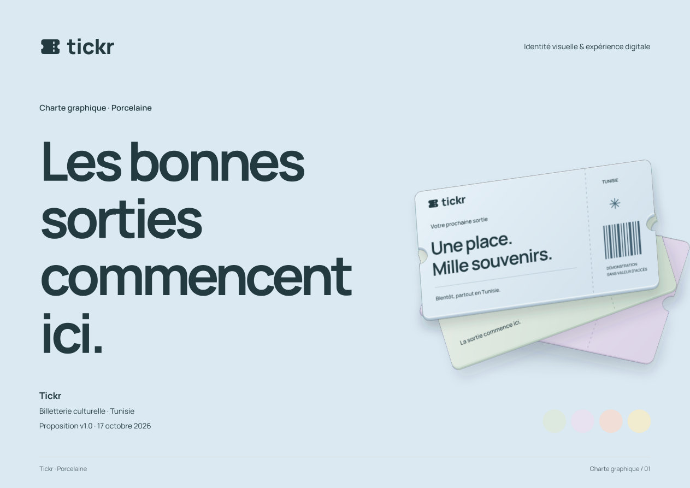
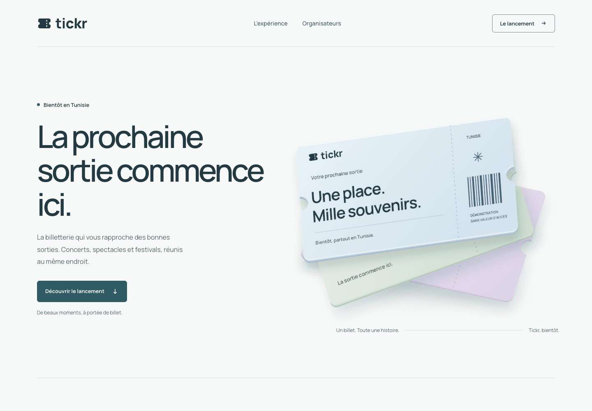

# Tickr · Porcelaine — charte graphique

Proposition visuelle v1.0 · **17 octobre 2026** · Français d’abord.

[**Document PDF · 24 pages**](tickr-charte-graphique.pdf) ·
[Source HTML](brand-book.html) ·
[Concept de lancement 3D](coming-soon.html) ·
[Références consultées](REFERENCES.md)



Une toile porcelaine, cinq pastels, une encre pétrole et Manrope. Un billet mat en
perspective porte le concept de lancement. Aucun halo lumineux, néon ou compte à
rebours fictif.

Le document rassemble l’identité et ses variantes, les couleurs, les polices, la
hiérarchie, les grilles, les composants et leurs états, la direction photo et 3D,
les versions desktop et mobile, les exemples de découverte, achat et billet, les
supports sociaux, le mouvement et le ton de voix.



## Consulter

Le PDF se consulte directement. Pour les versions HTML, depuis la racine du dépôt :

```sh
python3 -m http.server 8793 --directory docs/11-brand-charter
```

Ouvrir `http://localhost:8793/brand-book.html` ou
`http://localhost:8793/coming-soon.html`. Les polices et illustrations sont locales,
sans ressource tierce nécessaire à l’affichage. Les HTML s’ouvrent aussi depuis le
disque.

## Actifs livrés

| Fichiers                                        | Rôle                                                   |
| ----------------------------------------------- | ------------------------------------------------------ |
| `brand-book.html`, `brand-book.css`             | Source éditable du document                            |
| `tickr-charte-graphique.pdf`                    | Document A4 paysage, 24 pages                          |
| `coming-soon.html`, `landing.css`, `landing.js` | Prototype responsive de lancement                      |
| `tokens.json`, `tokens.css`                     | 80 tokens synchronisés : couleurs, type, rythme, états |
| `assets/logo/`                                  | Signature et symbole SVG vectorisés, variantes, source |
| `assets/fonts/`                                 | Manrope, Readex Pro, licences et provenance            |
| `assets/ticket-sculpture.svg`                   | Illustration originale avec profondeur simulée         |
| `assets/previews/`                              | Captures du prototype et couverture du PDF             |
| `scripts/check-design.mjs`                      | Vérification des tokens, contrastes et actifs          |
| `scripts/render-artifacts.sh`                   | Régénération des captures et du PDF                    |

La sculpture simule une matière 3D dans un SVG, sans moteur WebGL. Les lettres des
logos et du billet sont vectorisées.

## Vérifier et régénérer

```sh
node docs/11-brand-charter/scripts/check-design.mjs
node docs/11-brand-charter/scripts/check-design.mjs --json
bash docs/11-brand-charter/scripts/render-artifacts.sh
```

Le contrôle vérifie les **80 tokens et 37 paires de contraste** déclarées. Le minimum
calculé pour le texte est **4,72:1**. Il ne constitue pas un audit complet
d’accessibilité. Sur sauge, lilas et coquillage, employer le pétrole pour les
contours des contrôles ; #75878C est réservé aux autres surfaces autorisées.

La régénération demande Node.js/npm, Python 3 et Chrome/Chromium accessible à
Playwright CLI. Le script utilise `@playwright/cli@0.1.22` via `npx` ; la première exécution
peut télécharger cet outil. La couverture demande aussi PyMuPDF, installable dans
un environnement temporaire. Les fichiers livrés restent consultables sans ces
outils.

## Portée

Porcelaine est la nouvelle proposition visuelle soumise dans cette PR. Elle
renouvelle les choix de couleur et de typographie de
[Chaux & Faïence](../10-project-audit/08-global-design-direction.md). Les
[exigences produit et parcours](../08-frontend/README.md) restent la référence
métier. Le frontend et le backend applicatifs ne sont pas modifiés.

Le formulaire est une **démonstration locale** : consentement décoché, validation,
erreurs et confirmation explicites ; aucune requête, adresse conservée ou
inscription réelle. Sans JavaScript, le bouton reste désactivé. Avant publication,
relier une collecte réelle et ses textes de consentement à un service adapté.

Les événements, noms, prix et références de billet sont fictifs. Le QR est
volontairement non scannable. Aucune date de lancement ou métrique d’audience n’est
annoncée comme acquise. La surface sombre du billet est un exemple ciblé ; le thème
sombre complet reste à spécifier.
